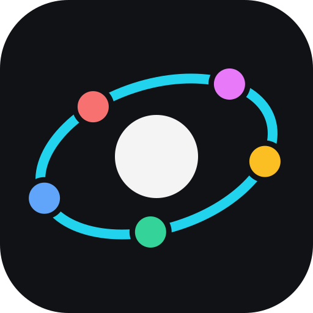
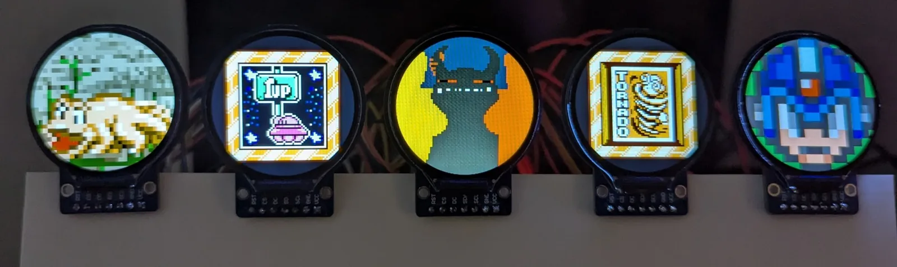
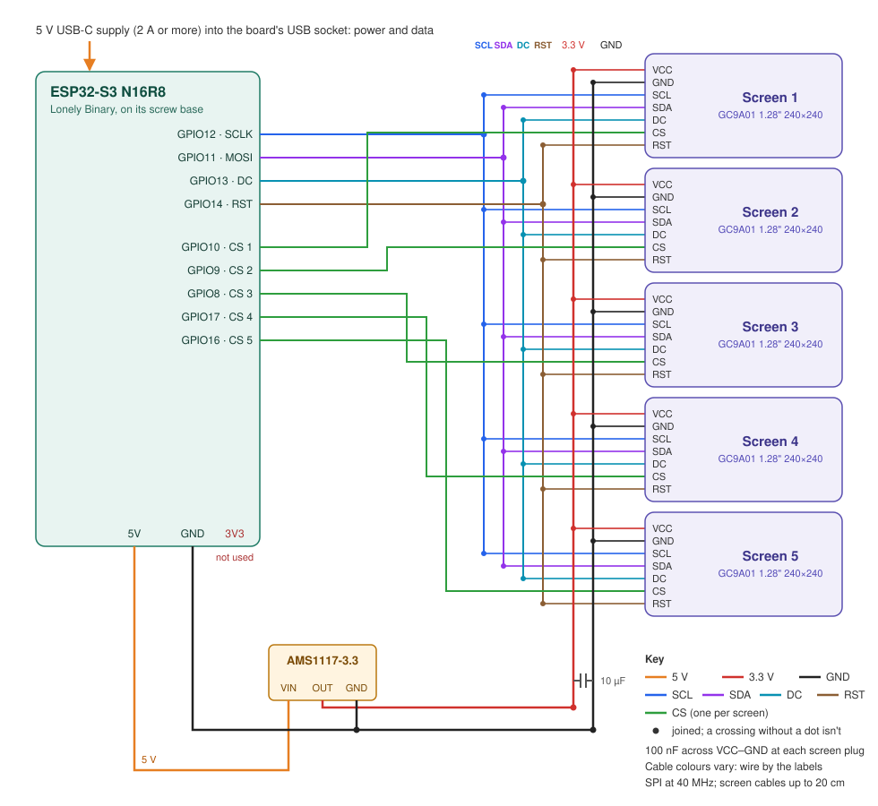

<div align="center">
  

  <h1>Orbit Station</h1>

  <p>Five round screens on an ESP32-S3,<br><strong>each one showing whatever you send it</strong><br>— clocks, gauges, weather, prices, countdowns, live PC stats, your own drawings, or animated pixel art from <a href="https://makapix.club">Makapix Club</a>.</p>

  <p>
    
    
    
    
    
  </p>
</div>

Firmware for a desk display of five 1.28" round screens, built around one
idea: every screen is a slot you fill over the network. There are no buttons
and no fixed widgets; a client (the
[OrbIt Command Center](https://github.com/billydavis/OrbIt-Command-Center)
desktop app, a script, `curl`) tells each screen what to show through a small
REST API, and the board remembers it.

<p align="center">
  
</p>

> **Status:** works on a breadboard prototype and has been through each of its
> build phases on real hardware (see [PLAN.md](PLAN.md)). A custom PCB is
> being designed; until then, build it on a breadboard as below.

## Where it came from

Orbit Station grew out of [**info-orbs**](https://github.com/brettdottech/info-orbs)
by [brett.tech](https://github.com/brettdottech), the open-source five-orb
desk display. Its OrbIt widget, which turned the orbs into five screens you
assign over an API, worked so well that it outgrew the original ESP32: there
wasn't the memory to decode Makapix's animated pixel art (images had to be
capped at 128 px and only the first frame shown) alongside everything else.

So this is OrbIt on its own, with more horsepower: an ESP32-S3 with 8 MB of
PSRAM and 16 MB of flash, new firmware with OrbIt at its core rather than one
widget among many, and the same orbit-api, so clients written for the info-orbs
OrbIt widget work unchanged. Thank you to brett.tech and everyone who has
contributed to info-orbs for the idea, the hardware it started on, and the
code this builds on.

## Parts

For the breadboard build. Quantities are for one Orbit Station.

| Part | Qty | Notes |
| ---- | --- | ----- |
| ESP32-S3 N16R8 dev board | 1 | 16 MB flash, 8 MB octal PSRAM. Built and tested on the Lonely Binary ESP32-S3 (Gold Edition, ESP32-S3-WROOM-1). Use its **USB** socket, not **UART** |
| ESP32-S3 screw terminal base | 1 | Lonely Binary's base for that board; optional, but it makes the wiring much easier |
| GC9A01 1.28" round TFT, 240×240 | 5 | The common 7-pin SPI modules: VCC, GND, SCL, SDA, DC, CS, RST (no backlight pin) |
| AMS1117-3.3 regulator module | 1 | Powers the screens. Pins are labelled VIN, OUT, GND (in that order on the common module) |
| Capacitor, 10 µF | 1 | Across the 3.3 V rail, at the regulator |
| Capacitor, 100 nF ceramic | 5 | One across VCC–GND at each screen's plug |
| Solderless breadboard | 1 | Half-size or larger, with power rails |
| 7-wire cable per screen, up to 20 cm | 5 | Tested at 20 cm and 40 MHz SPI; keep them that short |
| Jumper wires | — | Board to breadboard |
| 5 V USB-C power supply, 2 A or more | 1 | Five screens plus WiFi need more than a laptop port reliably gives; a phone charger or powered hub is fine |

A multimeter is very handy for checking the 3.3 V rail before connecting
screens.

## Wiring

<p align="center">
  
</p>

| Signal | ESP32-S3 | Screens |
| ------ | -------- | ------- |
| SPI clock | GPIO12 | SCL on all five |
| SPI data | GPIO11 | SDA on all five |
| Data/command | GPIO13 | DC on all five |
| Reset | GPIO14 | RST on all five |
| Chip select | GPIO10, 9, 8, 17, 16 | CS of screen 1, 2, 3, 4, 5 (one each) |
| 3.3 V | AMS1117 **OUT** | VCC on all five |
| Ground | board GND and AMS1117 GND | GND on all five |
| 5 V | board **5V** | AMS1117 **VIN** |

Things that matter (each one learned the hard way on the prototype):

- **Power the screens from the AMS1117, never from the board's 3V3 pin.** The
  board's own regulator can't carry five screens and the WiFi radio together,
  and wiring both regulators to the same rail makes them fight. One board's
  regulator didn't survive it.
- **Check the AMS1117's orientation by its labels.** Turned round, VIN and GND
  swap places: it gets hot, the 5 V supply collapses and the board resets in a
  loop.
- **Wire by the labels, not the cable colours.** Screen cables don't agree on
  colours; on the prototype's, black is VCC and red is GND. Mark each plug's
  VCC side.
- **Plug screens in with the power off** where you can. A screen that is
  replugged while running recovers by itself within a few minutes.
- Keep screen cables to about 20 cm; the bus runs at 40 MHz.

## Build and flash

Requires [PlatformIO](https://platformio.org/) (the VS Code extension or the
`pio` command line). There are no prebuilt binaries; build it yourself:

```bash
pio run -e s3 -t upload        # build and flash over USB
pio device monitor             # serial log, 115200 baud
```

**First start.** With no WiFi saved, the board opens a hotspot called
`OrbitStation-xx` and the first screen shows what to do: join it from a phone,
pick your network on the page that opens (or browse to `192.168.4.1`), and
enter its password. Once it's online the screen shows its address,
`orbit-station-xx.local`. If it can't reach its network for a few minutes, the
hotspot opens again so you can fix it.

**Updates over WiFi.** After the first USB flash:

```bash
pio run -e s3-ota -t upload --upload-port orbit-station-xx.local
```

The board connects back to your PC to fetch the firmware, so allow incoming
TCP connections on port **47269** through your PC's firewall (Windows asks the
first time).

**Factory reset, without buttons.** Power the board on and off three times in
a row, each time for less than 10 seconds. The third start erases all
settings, WiFi included. Crashes, brownouts and flashing never count towards
this.

## Using it

Each screen shows one **control**, set with
`POST /orbit/api/v1/screens/{n}` (screens are numbered 0–4):

```bash
curl -X POST http://orbit-station-xx.local/orbit/api/v1/screens/2 \
     -H "Content-Type: application/json" \
     -d '{"control":"time","params":{"showDate":true,"showDay":true}}'
```

| Control | Shows |
| ------- | ----- |
| `time` | Digital time, optionally with date and weekday |
| `analogClock` | A clock face with hour, minute and second hands |
| `gauge` | A ring, speedometer or instrument gauge for any value |
| `sysMonitor` | CPU, GPU, RAM and drive temperature at a glance |
| `countdown` | A timer that flashes "TIME'S UP"; `stop` puts back what was there |
| `weather` | Current conditions, temperature or forecast text (Visual Crossing) |
| `ticker` | A stock, crypto or forex price card (twelvedata) |
| `custom` | Your own drawing: text, lines, shapes and arcs |
| `screensaver` | Asteroids, matrix rain, warp, an orrery or radar, or all in turn |
| `makapix` | Animated pixel art from Makapix Club, crisp or filling the screen, with a transition between pieces (`transition`: `random`, `none`, or an effect listed in `/orbit/api/v1/capabilities`) |
| `blank` | Nothing |

The full request and response formats are the **orbit-api v1** spec, shared
with info-orbs' OrbIt widget: see
[`docs/orbit-api.md`](https://github.com/billydavis/OrbIt-Command-Center/blob/master/docs/orbit-api.md)
in OrbIt Command Center. `makapix` is Orbit Station's addition.

Board-wide endpoints:

| Endpoint | Purpose |
| -------- | ------- |
| `GET /api/v1/system` | Address, WiFi, memory, uptime, and the reason for the last restart |
| `GET`/`POST /api/v1/settings` | Timezone (`"America/Chicago"`), units, default weather location, and the weather and ticker API keys (reported masked) |
| `GET /api/v1/makapix` | Makapix pairing state; `POST /api/v1/makapix/forget` starts over |
| `GET /api/v1/log` | The last few dozen events: restarts and why, failed fetches, warnings |
| `GET /api/v1/capabilities` | What this firmware supports |

**Weather and prices** need free API keys from
[Visual Crossing](https://www.visualcrossing.com/) and
[twelvedata](https://twelvedata.com/), set once:

```bash
curl -X POST http://orbit-station-xx.local/api/v1/settings \
     -H "Content-Type: application/json" \
     -d '{"weatherApiKey":"…","tickerApiKey":"…","weatherLocation":"London, UK"}'
```

**Makapix** needs no keys. The first time a screen is set to `makapix`, it
shows a six-character code: register the board at
[makapix.club](https://makapix.club) with it, and art starts appearing. The
board keeps its own credentials from then on.

What each screen shows (and its settings) is saved on the board and comes
back after a restart. Live values a client keeps sending, like a gauge's
value or sysMonitor's readings, are never written to flash, so updating them
every few seconds forever does no harm.

## How it works

| Piece | What it does |
| ----- | ------------ |
| Display core | Each screen has two 240×240 pictures in PSRAM. Controls draw a whole picture on one core; a sender on the other compares it with what the screen shows, 16×16 tiles at a time, and sends only the tiles that changed. About 20 frames per second on each of five screens at once |
| Controls | One class per control: checks its params, draws its picture, and says which of its params are settings (saved) and which are live data (not saved) |
| Layout | Which control each screen shows, saved in NVS only when it actually changes; drawings in their own LittleFS files |
| Feeds | A background task fetches weather and prices, only for what a screen is showing, one HTTPS connection at a time |
| Makapix | Pairs the board as a Makapix player, fetches each feed's posts, and decodes PNG, GIF, WebP and BMP art into PSRAM for playback |
| Health | A watchdog over every task, a memory watch, a quiet refresh of one screen every 30 s (so a replugged screen recovers), and an event log |

## Files

- `src/display/` — the five-screen driver: LovyanGFX setup, the tile-diff
  sender, re-initialising a screen without disturbing the others
- `src/orbit/` — the layout, saving and restoring it, the orbit-api routes,
  and the render task; `controls/` has one file pair per control
- `src/net/` — WiFi, the setup hotspot, mDNS, updates over WiFi, factory reset
- `src/data/Feeds` — weather and price fetching
- `src/makapix/` — the Makapix player client and the image decoders
- `src/core/` — settings, timekeeping (SNTP and timezones), health
- `src/api/` — the board-wide endpoints
- `lib/` — OpenFontRender (TrueType text) and libwebp (decode only), vendored
- `docs/wiring.svg` — the wiring diagram above, generated by
  `docs/make_wiring.py`
- `PLAN.md` — the build phases and what each one found on real hardware

## Roadmap

- **A custom PCB**: a carrier for the dev board with its own 3.3 V supply for
  the screens, bulk capacitance for WiFi's current bursts, and five screen
  connectors laid out for short cables. Its schematic will join the wiring
  diagram here once it's designed.
- Plug detection, so a screen is re-initialised the moment it's connected
- An enclosure

## Credits

- [info-orbs](https://github.com/brettdottech/info-orbs) by brett.tech and
  contributors: the project this grew out of, its OrbIt widget and orbit-api,
  and the weather icons
- [Makapix Club](https://makapix.club) ([fabkury/makapix](https://github.com/fabkury/makapix)):
  the pixel art and its player API
- [LovyanGFX](https://github.com/lovyan03/LovyanGFX) (MIT / BSD-2-Clause),
  [OpenFontRender](https://github.com/takkaO/OpenFontRender) with FreeType,
  [libwebp](https://github.com/webmproject/libwebp) (BSD),
  [PNGdec](https://github.com/bitbank2/PNGdec) and
  [AnimatedGIF](https://github.com/bitbank2/AnimatedGIF) (Apache 2.0),
  [ArduinoJson](https://arduinojson.org/) (MIT),
  [WiFiManager](https://github.com/tzapu/WiFiManager) (MIT)
- [Roboto](https://fonts.google.com/specimen/Roboto) (Apache 2.0) and
  timezone rules from [posix_tz_db](https://github.com/nayarsystems/posix_tz_db) (MIT)

## License

[GNU AGPLv3](LICENSE.txt), the license
[info-orbs](https://github.com/brettdottech/info-orbs) itself uses.
